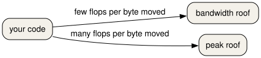

::: questions
- What does a single timing tell you, and what does it fail to tell you?
- When does adding cores stop helping?
:::

::: objectives
- Time a command with `time -p` and read the `real` line as wall-clock seconds.
- Compute speedup and parallel efficiency from a table of timings.
- Separate a strong-scaling study from a weak-scaling study.
- Give one reason an efficiency of 1.0 is rare.
- Place a kernel on a roofline as limited by arithmetic or limited by memory movement.
:::

## Wall-clock time

`time -p` is the POSIX form. It prints three lines to standard error: `real`, `user`, and `sys`. `real` is the elapsed time you waited. `user` and `sys` add up CPU time, which can be larger than `real` when several cores run at once.

``` {.bash org-language="sh"}
time -p python3 episodes/files/pi_one.py
```

Set `SAMPLE_COUNT` if you want a longer run. The `real` line is the one to write in a table. A single measurement is noisy. For a number you will compare, run the same command three times and keep the middle `real` value. This lesson\'s table is already collected that way, so the exercises use the table instead of asking you to produce a stable benchmark during class.

On the EESSI client the same `time -p` works, because it is a shell keyword or a system command, not a module.

## Strong and weak scaling

Strong scaling keeps the problem the same size and adds cores. The hope is that the same work finishes sooner. Speedup is `T(1) / T(N)`. Parallel efficiency is `T(1) / (N * T(N))`. An efficiency of 1.0 would mean every new core pulled its full weight. Communication, startup, and parts of the program that do not parallelise pull the number down.

Weak scaling grows the problem with the cores, so each core keeps the same amount of work. The hope is that the time stays about the same. A weather model on a larger region is often a weak-scaling question. A fixed video frame is often a strong-scaling question.

These timings are the worked strong-scaling series in `episodes/files/timings.csv`. The problem size stays fixed. The efficiencies are 1.000, 0.909, 0.800, and 0.625.

<div class="table-responsive">

| Cores | Seconds | Speedup | Efficiency |
|-------|---------|---------|------------|
| 1     | 8.0     | 1.000   | 1.000      |
| 2     | 4.4     | 1.818   | 0.909      |
| 4     | 2.5     | 3.200   | 0.800      |
| 8     | 1.6     | 5.000   | 0.625      |

</div>

Eight cores finish in 1.6 seconds instead of 8.0. The speedup is 5, not 8. The efficiency is 0.625. Those last cores still helped, and they helped less than the first ones.

::: callout
A faster `real` time with poor efficiency can still be the right choice when the queue gives you the cores and the person is waiting for the result. Efficiency tells you how much of the machine you used. It does not, by itself, tell you to use fewer cores.
:::

## A roofline, in one picture

Two ceilings show up once the program is already parallel. The figure names them the bandwidth roof and the peak roof. Your code sits under one of them.

The peak roof is how fast the cores can do arithmetic. If the kernel does a lot of arithmetic on each byte it reads, it can reach that roof.

The bandwidth roof is how fast bytes move. If the kernel does little arithmetic per byte, it hits that slope first. Adding cores does not help a kernel that is already waiting on memory, until you also give it more memory bandwidth.

Arithmetic intensity is arithmetic per byte moved. A low intensity sits under the bandwidth roof. A high intensity sits under the peak roof. You do not need a profiler to use the picture. You need it so that \"use more cores\" is not your only idea.



## A faded efficiency

``` text
efficiency = ________ / (cores * ________)
```

The first blank is the one-core time. The second is the time at that core count.

:::: challenge
## Predict the eight-core efficiency

The table says 8.0 seconds on one core and 1.6 seconds on eight. What is `8.0 / (8 * 1.6)`? Write the decimal before you run the checker.

::: solution
## Solution

0.625. The checker prints one efficiency per row and checks that the last row matches.

``` bash
python3 episodes/files/exercises/scaling-table.py
```

    1 1.000
    2 0.909
    4 0.800
    8 0.625
:::
::::

:::: challenge
## Time one short run

From the lesson directory, with `python3` available:

``` {.bash org-language="sh"}
SAMPLE_COUNT=1000 time -p python3 episodes/files/pi_one.py
```

Which of the three `time` lines is the wall-clock time? Run it twice. Do the two `real` lines match to the hundredth of a second?

::: solution
## Solution

`real` is the wall-clock time. `user` and `sys` are CPU time. Two runs of a 1000-sample estimate often differ in the hundredths, because the machine is doing other work. That is why a comparison uses a repeated measurement, or a table collected under the same conditions, rather than one lucky run. The `pi_one.py` estimate line itself does not change between runs. Only the timing does.
:::
::::

::: keypoints
- `time -p` prints `real`, `user`, and `sys`. `real` is the time you waited.
- Strong scaling fixes the problem size. Weak scaling grows it with the cores.
- Efficiency is `T(1) / (N * T(N))`. The sample eight-core efficiency is 0.625.
- A roofline separates a kernel limited by arithmetic from one limited by memory movement.
- Compare timings of the same work. One noisy run is a weak basis for a claim.
:::
