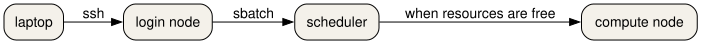

::: questions
- What is different about a supercomputer and the computer on your desk?
- How do you log in to Snellius, and how is the course cluster different?
:::

::: objectives
- Describe a supercomputer as a login node, a scheduler, and compute nodes.
- Identify a login hostname and a compute hostname from a written example.
- Connect to Snellius with SSH after the SURF user portal step.
- Connect to the course cluster with the address in your welcome note.
- Predict what a long computation does to a shared login node.
:::

## A room of computers, with a door

A supercomputer is not a bigger laptop. It is many computers in one room. They share a door, a queue, and file systems. You talk to the door. A scheduler decides when your work may run on a computer in the room.

You will meet three roles.

- The **login node** is the door. You reach it with SSH, or with a web shell. It is shared with everyone else who is logged in. It is the right place to edit a script, look at a small file, and submit a job. It is the wrong place to run the job.
- The **scheduler** is the queue. On Snellius and on the course cluster the scheduler is Slurm. You describe the resources you need. Slurm starts the work when those resources are free.
- A **compute node** is where the work runs. You do not SSH there for a normal batch job. Slurm starts your script on that node and writes the text output to a file.



## Snellius

Snellius is the Dutch national supercomputer, operated by SURF. The public description is at <https://www.surf.nl/en/services/compute/snellius-the-national-supercomputer>. Before the first SSH login you sign in to the SURF user portal, CUA. The account email comes from SURF and names your login.

From your own computer:

``` {.bash org-language="sh"}
ssh YOUR_LOGIN@snellius.surf.nl
```

Your prompt is on a login node. It looks like `YOUR_LOGIN@int4:~$`. The `int` names are login nodes. A compute node has a different name. If the network you are on is not trusted, SURF documents a separate door node in the service desk. Use that host when the welcome mail tells you to.

You can also work in a browser through Open OnDemand. That page gives you a shell, a file manager, and a few applications. The shell is still a login node.

::: callout
A password prompt on the login node is normal. A job does not start because you logged in. Logging in only gives you the door.
:::

## The course cluster

This course also uses a small cluster built from SURF Research Cloud workspaces. The template is Magic Castle: <https://github.com/ComputeCanada/magic_castle>. Your trainer sends a setup link. That link creates your password. There is one login node, and there is no CUA account.

``` {.bash org-language="sh"}
ssh YOUR_LOGIN@MANAGER
```

`MANAGER` is the address in the welcome note. It is not `snellius.surf.nl`. The nodes have two cores each, with more cores on the GPU node. Ethernet stands in for the fast network Snellius uses. The partition names `rome` and `thin_course` point at the same CPU nodes. The `gpu` partition holds the GPU cards.

There is no project budget on the course cluster. `accinfo` is not installed. `sacct` still reports core-seconds in `CPUTimeRAW`. On Snellius your project does have a budget, counted in system billing units. You do not need the budget command for the exercises in this lesson.

## A faded login

Fill the blank for the machine you are actually using.

``` {.bash org-language="sh"}
ssh ________@________
```

On Snellius the host is `snellius.surf.nl` and the name is your CUA login. On the course cluster both values come from the welcome note.

The sample SSH config in `episodes/files/ssh-config-sample` is the Snellius shape:

``` {.bash org-language="sh"}
Host snellius
  HostName snellius.surf.nl
  User YOUR_LOGIN
```

:::: challenge
## Predict the hostname

You are about to run `hostname` after logging in. Write down what you think the name will start with, before you run it.

On Snellius, which of these is a login node: `int4`, or `tcn123`?

::: solution
## Solution

`int4` is a login node. Names that start with `int` are the shared door. A name like `tcn123` is a compute node. You should see an `int` name when you run `hostname` on Snellius just after SSH. On the course cluster there is one login node, and its name is the one in your welcome note, not an `int` name.
:::
::::

:::: challenge
## Check a Snellius SSH config

From the lesson directory, run the offline check:

``` bash
bash episodes/files/exercises/login-checklist.sh
```

    hostname=snellius.surf.nl

What does the script refuse to accept?

::: solution
## Solution

It reads `HostName` from `episodes/files/ssh-config-sample` and exits with an error if that value is not `snellius.surf.nl`. A course-cluster address belongs in a different `Host` block, not in this one.
:::
::::

:::: challenge
## Log in for real

On Snellius or the course cluster, run:

``` {.bash org-language="sh"}
hostname
sinfo -s
who
```

In the EESSI client container there is no Slurm, so `sinfo` will not exist. Run `hostname` there anyway, and compare it with the cluster. Setup for the container is on the setup page.

::: solution
## Solution

On Snellius, `hostname` starts with `int` and `sinfo -s` lists partitions such as `rome` and `genoa`. On the course cluster, `sinfo -s` shows the small partitions, including `thin_course` or `rome`. `who` shows other people on the login node. That is the reminder: the door is shared.

The container prints its own hostname. That name is the container, not a SURF node. You use it for the software exercises, not as a substitute for `sinfo`.
:::
::::

## What you do next

You have a shell on a shared door. The next episode loads the software you will run. The episode after that sends the work through Slurm so it does not stay on this door.

::: keypoints
- A supercomputer is a login node, a scheduler, and compute nodes.
- `ssh YOUR_LOGIN@snellius.surf.nl` reaches Snellius after you have a CUA account.
- The course cluster is a Magic Castle workspace. Its address is in your welcome note.
- `hostname` on a Snellius login node starts with `int`.
- A long computation does not belong on the login node.
:::
