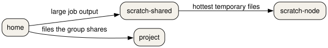

::: questions
- How long does a file last on home, on scratch-shared, in `$TMPDIR`, and on the project space?
- What does a Snellius quota line say, and what do you run when `myquota` is not there?
:::

::: objectives
- Match home, scratch-shared, scratch-local, scratch-node, project, and archive to a lifetime.
- Read a 200 GiB home quota and a three-week restore window for deleted home files.
- Use the tab's paths on the course cluster instead of the Snellius paths.
:::

## Six places on Snellius

A path decides the speed, the backup, and the day the file disappears. On Snellius the layout is a table. Learn the table, then read the tab. If your tab does not list a path, that path is not on your machine. Do not create it because the table has the name.

| Place | Speed | Size | Backed up | When it ends |
| --- | --- | --- | --- | --- |
| `/home` | Normal | 200 GiB | Yes | Project end, plus 15 weeks |
| `/scratch-shared` | Fast | 8 TiB, shared with scratch-local | No | 14 days |
| `/scratch-local` | Fast | Counted in that 8 TiB | No | 6 days |
| `/scratch-node` | Very fast | The node disk, no quota | No | End of the job |
| `/projects` | Fast | On demand | No | End of the project |
| `/archive` | Very slow | On demand | Yes | End of the project |

Home is `/home/$USER`. The quota is 200 GiB. The file system is backed up overnight. A home file that has already been backed up can be restored for three weeks after you delete it. The directory itself lasts until the project ends, plus 15 weeks. Three weeks is how long a deleted file stays in the backup. Fifteen weeks after the project is when the directory itself goes away.

Home is the right place for scripts, configuration, and small inputs. It is a poor place for a multi-gigabyte output. The backup has to copy what you put there, and the quota is the smallest cap in the table.

Scratch is fast temporary space. The default scratch quota is 8 TiB, counted across scratch-local and scratch-shared for your user. There is no backup.

Scratch-shared is `/scratch-shared`. The login node and the compute nodes can see it. You make your own directory, `/scratch-shared/$USER`. Data that sits unused is removed after 14 days. Use it for large job output that other nodes, or a later job this week, must read.

Scratch-local is a directory on that same GPFS scratch, created for a job and reached as `$TMPDIR`. The path looks like `/scratch-local/$USER.$SLURM_JOB_ID`. `realpath` shows a GPFS path under `/gpfs/scratch1/nodespecific/`. The directory is specific to the job. A second job on the same node gets a different directory. The table gives it 6 days. It counts against the 8 TiB quota, so old job directories still count until they expire.

Scratch-node is NVMe on the node itself. `$TMPDIR` points at your directory under `/scratch-node` when the job asked for it. It is removed when the job ends, so a result you need has to be copied off before the script exits. There is no quota and no backup. On Snellius it is not on every node. Fat nodes have it, and a subset of the `rome`, `genoa`, and GPU nodes have it. The request is `--constraint=scratch-node`. A shared node gives you a portion of that disk, not the whole device.

Project space is `/projects`. It is fast, it is not backed up, and it lasts until the project ends. This is the place for a result the group must keep, and for data that is too big for home. The size is on demand.

Archive is `/archive`. It is very slow, it is backed up, and it lasts until the project ends. It is for data you will not read during the run. The Snellius tab below names it as tape, and as a path you use from the login and staging nodes.

{alt='Where a file goes. The nodes drawn are home, scratch-shared, project, and scratch-node. The arrows read large job output, files the group shares, and hottest temporary files.'}

## The course cluster does not have this list

The table is Snellius. The course cluster has a shorter set of paths. Read them from the tab. Do not type `/scratch-shared`, `/scratch-node`, or `/archive` unless the tab lists them.

::: sites scratch-places
:::

On the course cluster the tab has home, a project path, a scratch path, and `$TMPDIR` for the job. There is no `/scratch-shared`, no `/scratch-node`, and no `/archive`. `$TMPDIR` is removed when the job ends. A file on the login node's scratch is not the same file as a compute node's scratch. The later episode writes job files inside the job.

## Read the quota before you fill it

The command depends on the machine. On Snellius, `myquota` prints bytes and inodes for home and for scratch. A home line from the documentation looks like this:

``` text
scur1448@home4|GiB:quota=200.00,limit=210.00,usage=0.0000%|Inodes:quota=1000000,limit=1200000,usage=0.0008%
```

`quota` is the amount you are given. `limit` is a little above that. `usage` is how full you are. Home is 200 GiB and 1,000,000 inodes. Scratch is 8 TiB across scratch-local and scratch-shared. Inodes are the metadata count from the previous episode. A small `usage` on bytes can still sit next to a full inode quota if the directory is many tiny files.

On the course cluster there is no `myquota`. `df -h` prints size, used, and free for a mount. `du -sh ~` prints one size for your home.

::: callout
## Type along

Run the command in the tab. Read the home number before you copy a large tree.
:::

::: sites quota
:::

## A job directory is not a place you keep

`$TMPDIR` inside a job is space for that job. Copy anything you must keep to home or to the project path before the script exits. The login node's `$TMPDIR` is a different directory. Do not prepare a job's files there and expect the compute node to see them.

::: sites tmpdir
:::

Scratch-node is the fast case of the same idea, and only on Snellius. The constraint is how you ask for a node that has the disk. The course cluster tab tells you to drop the constraint.

::: sites scratch-node
:::

:::: challenge
## Which file is still there?

A job writes the same `run.dat` in three places:

- A. `/scratch-shared/$USER/run.dat` on Snellius
- B. `$TMPDIR/run.dat` in a scratch-node job on Snellius, or the job's `$TMPDIR` on the course cluster
- C. the project path from your tab, for example `/projects/$USER/run.dat` on Snellius

Nobody touches the files afterwards. Which copies still exist after the job ends? Which still exist 14 days later? Which still exist when the project ends?

::: solution
## Solution

After the job ends, A and C are still there. B is gone. Scratch-node is removed at the end of the job. On the course cluster the job's `$TMPDIR` is removed at the end of the job as well. The login node cannot open that path in the afternoon.

Fourteen days later, A is gone. Unused scratch-shared data is removed after 14 days. C is still there. B was already gone.

When the project ends, C ends with the project. A ended at 14 days. B ended with the job. Home is not one of these three. Home would last until the project ends plus 15 weeks, and a deleted home file can be restored for three weeks, but a large `run.dat` should not have been put there.

Scratch-local, the `$TMPDIR` you get without `--constraint=scratch-node` on Snellius, has its own lifetime. The table gives it 6 days, and it is not path B.
:::
::::

::: keypoints
- Snellius home is 200 GiB, backed up, with three weeks of deleted files in the backup.
- Scratch-shared lasts about 14 days. Scratch-local lasts about 6 days. Scratch-node ends with the job.
- Project space and the archive last until the project ends. The archive is the slow, backed-up copy.
- The course cluster tab replaces this list. Do not invent `/scratch-shared` there.
- `myquota` is the Snellius report. `df -h` and `du -sh` are the tools when it is absent.
:::
